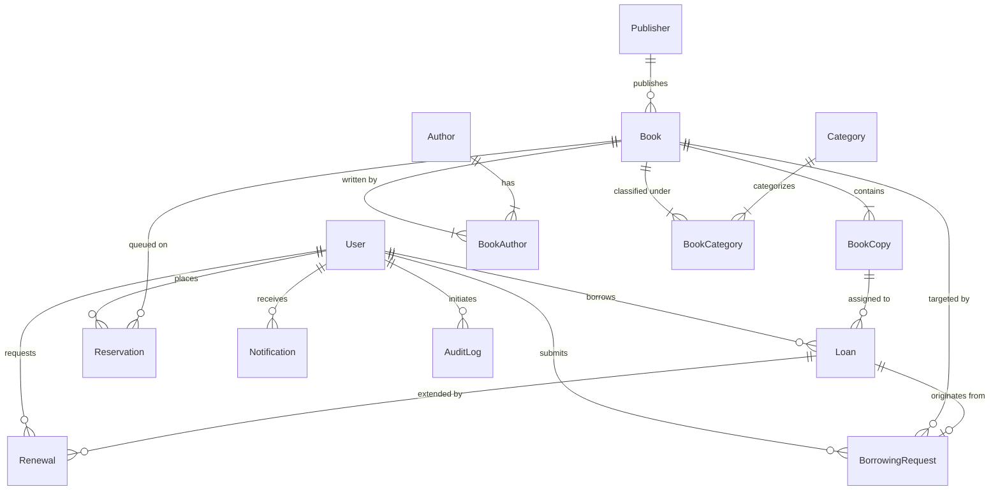

# LIBNEXA: Technical Architecture & System Design Document

**Institution**: Nasarawa State University, Keffi (NSUK)  
**Project**: LIBNEXA Monorepo — Campus Digital Library Catalog and Physical Circulation Management Platform  
**Target Environment**: Web, Mobile (Expo / React Native), and RESTful Backend API

---

## 1. Executive Architecture Overview

LIBNEXA is designed around a decoupled, domain-driven monorepo architecture. The platform manages the entire lifecycle of physical library resources across campus faculties:
- **Presentation Tier**:
  - `apps/web`: Single-Page Application (SPA) built with React 18, Vite, and Tailwind CSS. Provides specialized interfaces for Students, Circulation Librarians, and System Administrators.
  - `apps/mobile`: Cross-platform mobile client built with React Native and Expo SDK, designed for on-the-go book discovery, loan tracking, and displaying digital library passes (QR codes).
- **Application & Service Tier**:
  - `apps/api`: Express.js + TypeScript service implementing versioned REST endpoints (`/api/v1/*`), JWT authentication, Role-Based Access Control (RBAC), and automated background workers.
- **Shared Domain Tier**:
  - `packages/shared`: Canonical TypeScript interfaces, NSUK faculty/department taxonomy, library policy defaults, fine computation formulas, and common validators.
- **Data Persistence Tier**:
  - SQLite (`apps/api/prisma/dev.db`): Zero-dependency local development and testing.
  - MySQL 8.0+ (`database/init.mysql.sql` & `database/schema.mysql.prisma`): High-concurrency production database supporting strict ACID transactions, foreign keys, and indexes.

---

## 2. Core Entities & Data Model

### Key Relational Guarantees:
1. **Title vs. Physical Copy Separation**:
   - `Book` represents the bibliographic metadata (title, ISBN, publisher, edition, cover image).
   - `BookCopy` represents the physical item on the library shelf, tracked by a unique `accessionNumber`, barcode, physical `shelfLocation`, `condition`, and `status` (`AVAILABLE`, `RESERVED`, `ON_LOAN`, `UNDER_MAINTENANCE`, `WITHDRAWN`).
   - Availability is never an arbitrary integer; it is dynamically calculated by counting physical copies in `AVAILABLE` status.

2. **Circulation Lifecycle Integrity**:
   - Every physical borrow begins with a `BorrowingRequest`.
   - When approved by a circulation librarian, a specific `BookCopy` is locked.
   - Upon physical collection, a `Loan` record is created with an explicit `dueAt` timestamp, and the copy transitions to `ON_LOAN`.
   - Returns record the returning librarian, return timestamp, physical condition, and assess any overdue fines.

---

## 3. Role-Based Access Control (RBAC) Matrix

| Feature / Action | Student | Librarian | Super Admin |
| :--- | :---: | :---: | :---: |
| Search & Browse Catalogue | ✅ | ✅ | ✅ |
| Submit Digital Borrow Request | ✅ | ❌ | ❌ |
| Request Loan Renewal | ✅ | ❌ | ❌ |
| Place Waitlist Reservation | ✅ | ❌ | ❌ |
| View Digital Library Pass (QR) | ✅ | ❌ | ❌ |
| Review Borrow Requests (Approve/Reject) | ❌ | ✅ | ✅ |
| Confirm Physical Book Collection | ❌ | ✅ | ✅ |
| Process Book Returns & Condition Audit | ❌ | ✅ | ✅ |
| Manage Book Inventory & Physical Copies | ❌ | ✅ | ✅ |
| Review Loan Renewal Requests | ❌ | ✅ | ✅ |
| Configure System Circulation Policies | ❌ | ❌ | ✅ |
| Manage Staff & User Accounts | ❌ | ❌ | ✅ |
| View System Overview & Analytics | ❌ | ❌ | ✅ |
| Access Full Immutable Audit Logs | ❌ | ❌ | ✅ |

---

## 4. Background Schedulers & Workers

The API server embeds a cron scheduler (`src/services/reminderScheduler.ts`) running daily checks to:
1. Identify active loans that have passed their `dueAt` date.
2. Update loan status to `OVERDUE`.
3. Compute daily accumulated fines based on the university's configured `overdue_fine_daily_rate` and `grace_period_days`.
4. Trigger notification alerts to borrowers regarding imminent deadlines or accumulated penalties.
